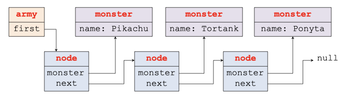

# The army of monster

**Goal:** Under the pretext of implementing a feature of a small game, this exercise has three distinct goals. The first goal is to learn how to manage memory. The second goal is to design dynamic arrays and linked lists. These classic data structures allow managing unbounded homogeneous sets. The third goal is to gradually lead you towards modular design, which will help us introduce object-oriented programming in the next lesson.

In our small game, slightly inspired by a 2016 AAA title, players walk around in the real world with their mobile phones to capture geo-located virtual monsters. These monsters are then used by players to conquer special locations, allowing players to interact.

The goal of the exercise is not to fully implement the game, but only the part of the game that manages the army of monsters. This implementation is made difficult because the whimsical game writers have planned that each player can acquire an unbounded number of monsters. For this reason, using a fixed-size array to store the monsters is impossible. We will therefore study data structures that allow managing an unbounded number of elements.

The exercise is divided into three parts:
- In the first part, we design the data structure that represents a monster.
- In the second part, we use a dynamic array to store our monsters. A dynamic array is a data structure based on an array, but it allows dynamically reallocating the array to extend it.
- In the third part, we observe that a dynamic array is not the most efficient data structure in terms of performance if the number of monsters becomes large. For this reason, we modify our application to use a linked list to store our monsters.

---

## The Monsters

### Question 1

In your local copy of the `csc_2f001_ep` repository, create a directory named `lab3`. Create a source file named `main.c`, in which a `main` print something. Download the file [Makefile](Makefile), compile your project by executing `make` in the terminal, and verify that a `army-pokemon` binary was generated.

Don't forget to add `Makefile` and `main.c` in the repository, to commit, and to push your commit to gitlab.

### Question 2

Read carefully the `Makefile`. You should see that there are no huge differences between this `Makefile` and the `Makefile` used in the previous lab. Mainly, you should see that, now, we generate the binary in two steps:
- In a first step (rule `%.o: %.c`), we generate an object file from the source file. Note the `-c` flag used in the recipe, which tells `gcc` to generate an object file instead of directly generating the binary.
- In a second step (rule `army-pokemon: main.o`), we generate the binary from the object files. In the recipe, `LDFLAGS` gives linking arguments, and `LIBS` gives the set of libraries required to generate the binary. Since we don't use libraries, `LIBS` is empty.

### Question 3

You will now define the data structure used to represent a monster (`struct monster`). Since you will use multiple source files in the next questions, you have to create this structure in a separated header named `monster.h`. The monster structure has two fields:
- The name of the monster. At this stage, the name has to be a pointer to an array of characters. You will see in the next questions that using a pointer happens to be a very bad choice.
- A number of health points (an integer).

### Question 4

In `monster.h`, add the declaration (not the implementation) of three functions:
- `create_monster`: the function creates a monster. It takes as argument the name and the number of health points of the monster, and return a pointer to a new monster.
- `display_monster`: this function takes as argument a pointer to a monster and prints its characteristics in the terminal (e.g., its name and its number of health points).
- `delete_monster`: this function takes as argument a pointer to a monster and frees its memory.

In a file named `monster.c`, add the implementations of the three functions. In `main.c`, use these functions to create a monster named `Pikachu`, to print it, and to delete it. Modify the `Makefile` in order to generate `army-pokemon` from `main.c` and `monster.c`.

### Question 5

Now, `main.o` and `monster.o` have to be recompiled when `monster.h` is modified. Modify `Makefile` accordingly.

🎉 **Congratulations! You wrote your first modular program!**

### Question 6

In main, we now want to create 10 monsters. For that, you need an array of monsters. In a first loop, creates the 10 monsters. For the moment, they are all named `Pikachu`. In a second loop, prints the 10 monsters. In a third loop, delete the 10 monsters.

### Question 7

We now want to name our monsters differently. We will name them `Pikachu-i` where `i` is a number between 0 and 9. For that, we will use the function `snprintf(char* buf, size_t n, char* fmt, ...)`. `snprintf` behaves like `printf` but, instead of printing the string to the terminal, it fills the buffer `buf` with the characters of the string. It also ensures that at most `n` characters are written in the buffer. To use `snprintf`, `main` has to use a temporary array of characters, and to fill it with the names at each iteration of the loop.

Why in the loop that displays the monsters, they happen to be all named `Pikachu-9`?

### Question 8

We will now correct the `struct monster` data structure. For that, instead of defining the name of a monster as a pointer, we have to define it as an array of 256 bytes. Modify the code of `monster.h` and `monster.c` accordingly. Verify that now, each monster has its own name.

### Question 9

This value 256 is used at several places. If we want to change it, adapting the code will be error-prone. For example, if we change the 256 into a 16 in the data structure, we have to change this 256 everywhere to avoid a buffer overflow, especially in `create_monster` where we copy the name in the monster data structure. To handle a case where we want to define a constant used at several places, the C language provides what is called a macro. To define a macro, you have to use the `#define` keyword. For example, in our case, we can define a macro `NAME_SIZE` with:

```c
#define NAME_SIZE 256
```

Before compiling the file, `gcc` replaces each occurrence of `NAME_SIZE` by its value (256 in our case).

Add the macro definition `NAME_SIZE` in `macro.h`, and replace each occurrence of 256 in the files by `NAME_SIZE`.

### Question 10

A macro can be anything. For example, if you write:

```c
#define NAME_SIZE I'm a crazy unicorn
```

then, `gcc` will blindly replace each occurrence of `NAME_SIZE` by `I'm a crazy unicorn`. The resulting code will not be syntactically correct. For example, the name field defined as `char name[NAME_SIZE]` will be blindly rewritten into `char name[I'm a crazy unicorn]`, which will lead to compilation errors.

Note also that a macro can take a parameter. In this case, a macro looks like a function. For example, we can define a macro `max` that computes a maximum like that:

```c
#define max(a, b) ((a) < (b) ? (b) : (a))
```

and then, we can use it with `max(2, 3)`. The difference between a function and a macro is that `max(2, 3)` is replaced by `((a) < (b) ? (b) : (a))`. At execution, we don't have a function call: the process does not create a stack frame, and does not jump to a code of a function. In this case, we say that the code of `max` is inlined. Inlining a code is much more efficient that calling a function since we don't have to create a stack frame, to transfer the arguments etc...

Using a macro is a good way to optimize the code, but it's not always the best solution because the code of a macro quickly looks ugly. When you want to inline a function, you can also define the function in a ".h" file in order to make the code of the function visible from all the ".c" files, and to prefix the function definition with the `inline` keyword, for example, as in:

```c
inline int max(int a, int b) {
  return a < b ? b : b : a;
}
```

Here, the code is prettier. However, you can only use `max` with integers, not, for example, with floats. The advantage of a macro is that you don't fix the types of the parameters, which means that the code of a macro is more generic. You will see in the next lessons how we can use inline functions in C++ without fixing the types.

That's all, you don't have a question in this question, you just had to read the text.

---

## The army as an extensible array

In this exercise, you will implement an army of monsters as an extensible array. An extensible array is a data structure that stores a set of elements in an array. When the array of monsters is full, the code has to allocate a larger array and to copy the elements from the old array to the new array. To define an extensible array of monsters, we will use this data structure:

```c
struct army {
  struct monster** monsters; // a pointer to an array, where each element of the array is a pointer to a monster
  int top;                   // where you have the last monster in the array
  int capacity;              // the capacity of the array
};
```

### Question 1

In a header file `army.h`, add the definitions of `struct army` along with the definition (not the implementation) of three functions:
- `create_army` allocates a `struct army` data structure. The function does not have an argument since initially, the army is empty.
- `add_monster_to_army` adds a monster to an army.
- `display_army` prints the monsters of the army in the terminal.
- `delete_army` deletes the army (both the army and the array `monsters`, but not the monsters themselves, which are supposed to be deleted by using the `delete_monster` function).

In a source file `army-pokemon.c`, implement the functions. Initially, `monsters` has to be initialized to NULL and `capacity` to 0. Whenever you reallocate the array, you must double its capacity, except when capacity is equal 0, in which case you have to use a capacity of 1. In `main.c`, adds your ten Pikachu in an army, and use `display_army` to print them.

---

## The army as a linked list

Unfortunately, this story about catching kawaii monsters didn't interest anyone. This is an economic disaster for your company and your CEO has to fire all the developers but you. Luckily, your ever-visionary CEO has a new great idea. She wants to launch a new franchise based on the movie [Black Sheep](https://www.allocine.fr/video/player_gen_cmedia=18799208&cfilm=125164.html) depicting the exciting adventures of zombie sheep. In this new game, a player accumulates zombie sheep by catching them like in the old game. However, now, the player roams the real world to encounter other players, and when they meet, their armies fight.

Since you are the last developer, your CEO suggests reusing the data structure from the previous game to implement the new one. However, 12 weird users bought the old game and threaten to sue your company if you don't maintain the old game. You don't have choice, you have to keep the code of the old and the new game at the same time.

### Question 1

Since a zombie has a name and health points, you can just reuse the code of `monster.h` and `monster.c` as is. Similarly, since "Pikachu" looks like a zombie name, you can also reuse the code of `main.c` as is. However, you have to create a new data structure for an army, because an army now has stars. The number of stars increases when the army wins a battle, which provides a battle bonus.

To reuse the code, you first have to copy `army-pokemon.c` into `army-zombie.c`. Then, you have to modify the `Makefile` in order to generate two binaries:
- The binary `army-pokemon` is generated from `main.o`, `monster.o` and `army-pokemon.o`,
- The binary `army-zombie` is generated from `main.o`, `monster.o` and `army-zombie.o`.

Note that the `%` pattern can appear where we want in a name in a Makefile. You can leverage that to define a generic rule `army-%: main.o monster.o army-%.o`.

### Question 2

To add stars to a zombie army, we cannot share the army data structure between the two versions of the game. For this reason, you have to remove the definition of `struct army` from `army.h` since `army.h` is used both in the pokemon and zombie games. For that, you first have to move the definition of `struct army` from `army.h` to `army-array.c` and `army-zombie.c`. However, if you totally remove `struct army` from `army.h`, you cannot use `struct army` in the function declarations of `army.h`. For this reason, to make `gcc` happy, you have to declare that `struct army` exists without giving its code by adding this line in `army.h`:

```c
struct army; // declare that a data structure named army exists
```

Now that we have two different data structures, we can modify `army-zombie.c`. Add a `stars` field (an integer) to `struct army` in `army-zombie.c` and initializes it to 0 in `army_create`. In `print_army`, before printing the monsters, print also "This is a n stars army" where n is the number of stars. Verify that the binaries `army-pokemon` and `army-zombie` behave as expected: `army-pokemon` should just print the army, while `army-zombie` should now additionally print "This is a 0 stars army".

### Question 3

This new story of zombie is an extraordinary success, congratulation. However, you start receiving tons of emails from unhappy users because your game's performance is terrible. After an in-depth performance analysis, you find that some obsessive players are collecting hundreds of thousands of zombies in their army. When the dynamic array is expanded to accommodate these players' new monsters, hundreds of thousands of cells are copied from the old array to the new one, which crushes the performance of your servers and impacts all players connected to the same server (this anecdote is, of course, imaginary, but resembles the performance issues you might encounter daily in a company).

To avoid these array copies, we will implement the army of zombies with a linked list. A linked list is a classic data structure that avoids copying at the cost of a longer traversal time for the elements. The idea is to build a chain of homogeneous elements, each referencing the next in the list. To do this, we introduce a new data structure called `struct node` that contains a pointer to a `struct monster` and a pointer to a next `struct node`.

The figure below shows the structure in a graphical form. Each box represents a data structure. The name at the top of the box indicates the name of the data structure, and the names below are the most important fields of the data structure. The arrows represent pointers. In this illustration, the army points to the first node of the linked list. The first node points the first monster (`Pikachu`) and the second node, etc.

[](linkedlist.png)

Modify `army-zombie.c` to implement the army as a linked list instead of an extensible array.

### Question 4

Submit your work. For that, start by running `git status` to identify the untracked files and to add them to the repository with `git add`. Then, commit your code (`git commit`) and push the commit to the gitlab repository (`git push`).

🎉 **Congratulations! You are now able to reuse C code in different projects!**